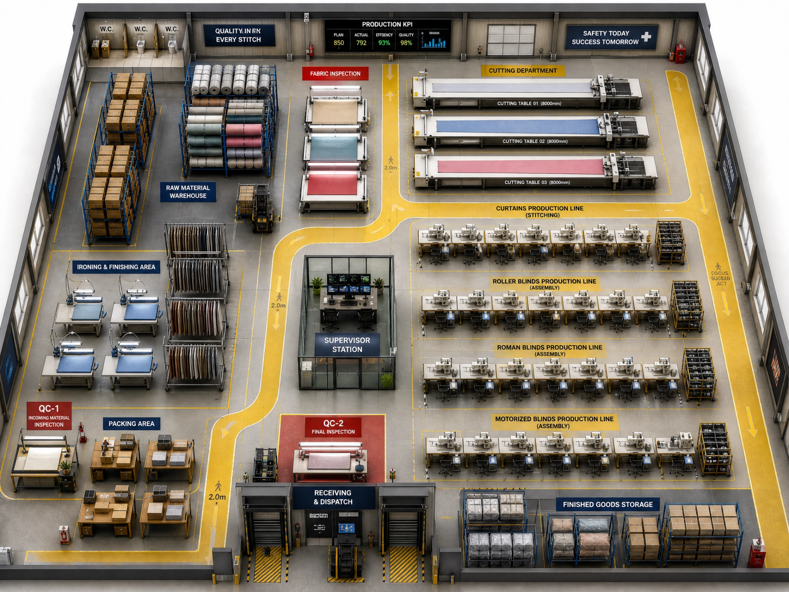

# 2D-to-3d-factory-vision
AI-assisted transformation of a 2D blinds and curtains factory layout into a 3D visual presentation, showcasing the manufacturing space and production arrangement

Converted a traditional factory layout into a 3D visual representation.
Showcased the layout of a blinds and curtains manufacturing facility.
Provided a clearer visual understanding of the factory arrangement
Used AI tools to enhance and transform the original layout.
**Industry** : Blinds and Curtains Manufacturing

**Tools and Technology :** AI-powered image generation and transformation tools.

**Project Purpose :** To demonstrate how AI can simplify the visualization of industrial spaces by converting conventional 2D layouts into engaging 3D presentations.

**Project Type** : AI-Assisted 2D to 3D Visual Design

**Final Output** : A 3D visual representation of a blinds and curtains manufacturing factory layout, developed from an original 2D floor plan.

**Project Vision** : Demonstrating practical applications of AI in manufacturing visualization, industrial design and business presentations.

---

## Factory Layout – 2D to 3D Visualization

This project demonstrates the transformation and visualization of a blinds and curtains manufacturing facility, using AI-assisted 3D image generation.

### 1. Factory Layout and Workflow Diagram

### 2. Factory Visualization – Image 1

### 3. Factory Visualization – Image 2

